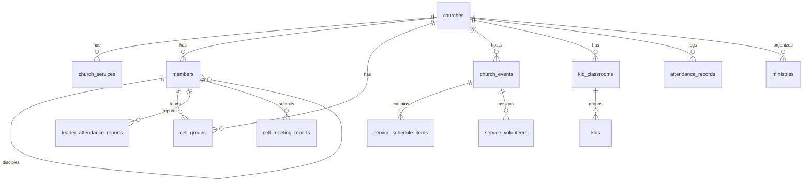

# CACHE DE ARQUITECTURA Y ESTADO DEL PROYECTO
**Proyecto:** Planeador Pastoral (IEC - Iglesia Emmanuel de Caja de Agua)  
**Versión:** 1.0.0 | **Expo SDK:** 58.0.19 | **React Native:** 0.88.0 | **React:** 19.3.0  
**Última actualización de caché:** 2026-10-26 (Actualizado a Expo SDK 58)  
**Estado de TypeScript:** 100% libre de errores (`tsc --noEmit` exitoso) | **Expo Doctor:** 20/20 pasados | **Expo Lint:** 0 errores, 0 advertencias

> **PROPÓSITO DE ESTE ARCHIVO:**  
> Este archivo sirve como caché persistente de contexto para que el asistente de IA y los desarrolladores no tengan que re-analizar todos los archivos y estructuras del proyecto en cada solicitud. Contiene la arquitectura completa, modelos de datos, reglas de negocio eclesiásticas, rutas, permisos y comandos operativos.

---

## 1. IDENTIDAD Y ALCANCE DEL PROYECTO

- **Nombre de la Aplicación:** Planeador Pastoral / IEC (Iglesia Emmanuel de Caja de Agua).
- **Propietario / Cuenta EAS:** `yonmar22` | Slug: `PaneadorPastoral` | Package Android: `com.yonmar.paneadorpastoral`.
- **Objetivo Principal:** Aplicación móvil universal para la gestión integral de la iglesia:
  1. Planeación litúrgica y órdenes de culto (Run-sheet / cronograma con tiempos y responsables).
  2. Gestión de voluntarios y ministerios con delegación a coordinadores.
  3. Estructura de discipulado G12 (árbol generacional 12-144-1728).
  4. Red de Células de crecimiento (reuniones en casas, asistencia y ofrendas multi-moneda).
  5. Registro y consolidación de asistencia dominical por categorías demográficas.
  6. Check-in / check-out de Iglesia Infantil con códigos de seguridad.
- **Identidad Visual / Icono:** Diseño pastoral y de gestión eclesial con Santa Biblia abierta en el centro, cruz en la página, congregación/comunidad tomada de la mano en unidad y discipulado, manos de apoyo pastoral y símbolos de gestión litúrgica (gráfica de crecimiento, reporte con checklist y corazón) sobre gradiente azul real (`#1E3A8A`). Totalmente limpio sin textos. Generado en 1024x1024 (`assets/images/icon.png`, `android-icon-foreground.png`, `splash-icon.png`, `favicon.png`).

---

## 2. STACK TECNOLÓGICO Y CONFIGURACIONES CRÍTICAS

| Componente | Versión / Herramienta | Notas de Integración |
|---|---|---|
| **Framework** | Expo SDK 58 (58.0.19) | React Compiler habilitado (`experiments.reactCompiler: true`), Typed Routes activadas. |
| **Core UI** | React Native 0.88.0, React 19.3.0 | Arquitectura Mobile-First. Estilos con StyleSheet / Vanilla CSS adaptativo (Light/Dark). |
| **Navegación** | Expo Router 58.0.26 (React Navigation 7) | Rutas basadas en archivos bajo `src/app/`. Barra de navegación en `src/components/app-tabs.tsx` con opciones e iconos memoizados para prevenir loops de re-render en `BottomTabView`. |
| **Base de Datos** | Supabase (`@supabase/supabase-js` ^2.118.0) | PostgreSQL con RLS abierto para anon. Conexión centralizada en `src/lib/supabase.ts`. |
| **Almacenamiento Local** | `@react-native-async-storage/async-storage` 2.2.0 | Persistencia de sesión de usuario y caché de ministerios sin conexión. |
| **Animaciones / UI** | `react-native-reanimated` 4.5.1, `@expo/vector-icons` | Iconografía Ionicons, splash animado nativo en `src/components/animated-icon.tsx`. |
| **Build & Deploy** | EAS Build (`eas.json`) | Perfiles `development`, `preview` (APK directo para Android) y `production`. |
| **Web & iOS PWA** | Expo Web Static Export (`public/manifest.json`, `src/app/+html.tsx`) | PWA instalable en iOS/Android mediante "Agregar al inicio", soporte offline, pantalla completa sin barras de navegador. Desplegado en Vercel: `https://paneadorpastoral123.vercel.app`. |

> [!WARNING]
> **Ejecución en Windows (PowerShell):**  
> La política de ejecución de scripts de Windows puede bloquear comandos como `npx expo` directos. Utilizar siempre `cmd /c npx <comando>` o `npx.cmd`.

---

## 3. DOMINIO Y REGLAS DE NEGOCIO ECLESIÁSTICAS

### 3.1. Redes de la Iglesia (`ChurchNetwork`)
1. **Red Juvenil (`juvenil`):** Culto juvenil dominical (11:00 AM). Pastores encargados: Pastor Josué Rodríguez y Pastora Norelis de Rodríguez.
2. **Red Adulta (`adulta`):** Cultos de adultos dominicales (9:00 AM y 1:00 PM). Pastores encargados: Pastor Carlos Diez y Pastora Neiyelis de Diez.
3. **Red General (`general`):** Servicio de Adoración de los viernes (6:00 PM) y eventos especiales transversales. Cobertura de los Pastores Principales.

### 3.2. Estructura de Discipulado G12
- **Roles (`MemberRole`):** `senior_pastor`, `network_pastor`, `g12_leader`, `volunteer`, `member`, `visitor`.
- **Niveles Generacionales (`generationLevel`):**
  - **Nivel 0:** Pastores Principales (`senior_pastor`) — Pastor José Peña y Pastora Neidy de Peña.
  - **Nivel 1:** Pastores de Red (`network_pastor`) — Carlos Diez, Neiyelis de Diez, Josué Rodríguez, Norelis de Rodríguez.
  - **Nivel 2:** Líderes de 12 (`g12_leader` o `isLeaderOf12 = true`).
  - **Niveles 3 y 4:** 144 y 1728 discípulos sucesivos.
- **Relación Jerárquica:** Cada miembro tiene `leaderId` y `leaderName`. La función `getLeaderInCharge(currentUser)` calcula dinámicamente quién recibe sus reportes de célula y asistencia.

### 3.3. Servicios Oficiales Regulares (`churchServicesSchedule`)
- `domingo_adultos_1`: Domingo 9:00 AM – 11:00 AM (Red Adulta)
- `domingo_juvenil`: Domingo 11:00 AM – 1:00 PM (Red Juvenil)
- `domingo_adultos_2`: Domingo 1:00 PM – 3:00 PM (Red Adulta)
- `viernes_adoracion`: Viernes 6:00 PM – 7:30 PM (Red General)

### 3.4. Consolidación y Categorización de Asistencia (`src/lib/attendance.ts`)
- **Regla Prejuvenil:** Toda persona menor de 14 años (`age < 14`) se clasifica automáticamente como `prejuvenil`, sin importar el sexo.
- **Categorías:** `hombres`, `mujeres`, `prejuvenil`, `sin_clasificar`.
- **Deduplicación:** La función `summarizeReports(reports, members)` totaliza el reporte del líder, sus discípulos presentes e invitados. Si un discípulo envía su propio reporte y además es marcado por su líder, se cuenta exactamente una sola vez (deduplicación por ID de miembro).

### 3.5. Grupos Celulares y Reportes de Reunión (`src/app/cells.tsx`)
- Campos de célula: Líder que predica (`cell_leader_name`), Cobertura de 12 (`leader_name`), Anfitrión (`host_name`), Asistente (`assistant_name`), Día, Hora, Red.
- Reporte semanal de reunión: Asistencia de miembros y de invitados (con nombre y edad), observaciones, y desglose de ofrendas multi-moneda (`usdCash`, `vesCash`, `pagoMovilAmount` + referencia bancaria).

### 3.6. Sistema de Ministerios y Permisos de Evento (`src/context/ChurchContext.tsx`)
- **Ministerios Predeterminados:** Alabanza, Audiovisual, Protocolo, etc. Cada uno con coordinador permanente y roles sugeridos (`defaultRoles`).
- **Permisos de Edición de Cultos/Eventos:**
  - `canUserEditFullEvent`: Pastores Principales y el creador del evento (`createdById`). Editan título, predicador, fecha, orden general y eliminan el evento.
  - `canUserEditEventPart`: Coordinadores asignados al evento (`EventMinistryAssignment`) o coordinadores permanentes del ministerio. Tienen permiso acotado para modificar los bloques del cronograma asignados a su ministerio y programar/confirmar servidores de su área.
  - `toggleVolunteerConfirmation`: El dueño del evento, el coordinador del ministerio o el propio voluntario pueden confirmar o desconfirmar su asistencia.

### 3.7. Segregación de Eventos por Red (`getVisibleEvents`)
- **Regla de Visualización:**
  - **Pastores Principales (`senior_pastor`):** Tienen visión general y ven **todos** los eventos de la iglesia (Adulta, Juvenil y General).
  - **Red Juvenil (`juvenil`):** Ven únicamente eventos de la **Red Juvenil** y eventos marcados como **General**. No ven eventos de adultos.
  - **Red Adulta (`adulta`):** Ven únicamente eventos de la **Red Adulta** y eventos marcados como **General**. Los eventos de jóvenes **nunca** les salen a los de la red adulta.
- **Implementación Centralizada:** Helper `getVisibleEvents(currentUser)` en `ChurchContext.tsx` consumido directamente por [planner/index.tsx](file:///d:/asdasd/iglesia/PaneadorPastoral/src/app/planner/index.tsx) y [index.tsx](file:///d:/asdasd/iglesia/PaneadorPastoral/src/app/index.tsx).

### 3.8. Autenticación y Flujo de Navegación de Sesión
- `login(email, password)` devuelve `LoginResult { success: boolean; error?: string }`.
- Si el usuario no existe en la BD: retorna mensaje explícito de cuenta no encontrada.
- Si el usuario tiene contraseña configurada y se ingresa una errónea: retorna error claro de contraseña incorrecta.
- En la interfaz de [login.tsx](file:///d:/asdasd/iglesia/PaneadorPastoral/src/app/login.tsx):
  - Banner de error visible en rojo (`errorAlertCard`) para evitar que el usuario se quede sin feedback visual si la alerta nativa es bloqueada o ignorada.
  - Resaltado en rojo del campo de contraseña (`inputWrapperError`).
  - Limpieza automática del error al comenzar a escribir.
- **Patrón de Sesión en [index.tsx](file:///d:/asdasd/iglesia/PaneadorPastoral/src/app/index.tsx):**
  - Para evitar ciclos infinitos de navegación (`RoutingQueueDrainer` / `Maximum update depth exceeded`) causados por `router.replace('/login')` mientras la pestaña de inicio permanece montada en segundo plano:
  - Si `isLoading === true`: Renderiza pantalla de carga centrada.
  - Si `!currentUser`: Renderiza `<LoginScreen />` directamente en la ruta raíz (`/`).
  - Si `currentUser`: Renderiza el panel pastoral completo.
  - Al cerrar sesión (`handleLogout`), `logout()` limpia `currentUser` y el login se muestra de inmediato sin transiciones o llamadas a `router.replace`.

### 3.9. Muro Pastoral con Spanish Bible API (Reina Valera 1960) y Sistema de "Me Gusta"
- **Objetivo:** Convertir el Inicio (`src/app/index.tsx`) en un feed espiritual donde los pastores publican mensajes y reflexiones devocionales y los miembros pueden leerlos y reaccionar con un "Me gusta" (❤️).
- **Integración con Spanish Bible API (`https://samueldaviddelacruz.github.io/spanish-bible-api/`):**
  - Implementado en [src/lib/bible.ts](file:///d:/asdasd/iglesia/PaneadorPastoral/src/lib/bible.ts).
  - Consulta directamente la versión **Reina Valera 1960** en español mediante el endpoint base `https://ajphchgh0i.execute-api.us-west-2.amazonaws.com/dev/api`.
  - **Búsqueda Avanzada y Flexible:**
    - **Insensibilidad total a acentos:** Admite escribir con o sin acento (`josue`, `Josué`, `jeremias`, `Jeremías`, `isaias`, `genesis`, `exodo`, etc.). La función `normalizeText` elimina marcas diacríticas Unicode (`\u0300-\u036f`).
    - **Separadores flexibles (espacios y dos puntos):** El usuario puede escribir `josue 1 9` y el parser interpreta el espacio entre el capítulo y el versículo como separador (`josue 1:9`, `josue 1 9`, `josue 1.9`, `1 corintios 13 4`).
    - **Soporte de rangos de versículos:** Detecta rangos como `josue 1 9-10`, `1 corintios 13:4-7` o `1 juan 4 18-19`. Consulta el endpoint `/verses/{capitulo}:{versiculoInicial}` que devuelve la lista de versículos del capítulo y filtra localmente hasta el versículo final, concatenando el texto con marcadores `[9] ... [10] ...`.
    - **Libros con números iniciales:** Soporta libros numerados (`1 juan 4 18-19`, `1 corintios 13 4-8`, `2 samuel 22 2-4`).
  - Mapeo de los 66 libros canónicos en español y sus abreviaturas habituales a los IDs del API (`Josh`, `Gen`, `John`, `Phil`, etc.).
  - Mapeo canónico inverso (`BOOK_CANONICAL_NAMES`) para retornar siempre referencias hermosas y con la acentuación correcta en pantalla (ej. `Josué 1:9-10`).
  - Incluye catálogo rápido de versículos populares en español (RVR1960) para inserción inmediata en un toque.
  - La vista previa del versículo permite editar o afinar el texto libremente antes de publicar.
- **Modelos de Datos:**
  - `BibleVerseAttachment`: `{ reference, text, translation }`.
  - `PastoralPost`: `{ id, authorId, authorName, authorRole, authorNetwork, network, title, content, verse, likes, createdAt }`.
  - **Identidad del Autor vs Red Destino:** La insignia del autor (`Pastor Juvenil`, `Pastor Adultos`, `Pastor Principal`) se determina por su rol y `authorNetwork` real, independiente de a qué red destina su publicación (`Toda la Iglesia`, `Para: Red Juvenil`, `Para: Red Adulta`).
- **Interacción Social:**
  - Botón de reacción minimalista con corazón y contador numérico (❤️ 5), sin textos redundantes, con actualización en tiempo real y persistencia en `@planeador_pastoral_posts_v1`.
  - Filtro por red: Jóvenes ven mensajes juveniles y generales; Adultos ven mensajes adultos y generales; Pastores Principales ven todos.


---

## 4. MAPA DE ARCHIVOS Y RUTAS

### 4.1. Pantallas y Rutas (`src/app/`)
- `src/app/_layout.tsx`: Layout raíz. Configura `SafeAreaProvider`, `ThemeProvider`, `ChurchProvider`, `AnimatedSplashOverlay` y `AppTabs`.
- `src/app/index.tsx`: **Muro Pastoral y Comunidad**. Feed de devocionales y mensajes pastorales con versículo bíblico adjunto (`bible-api.com`), botón de reacción "Me gusta", acceso rápido a escribir para pastores, píldora compacta del próximo culto y accesos directos a los módulos de gestión.
- `src/app/planner/index.tsx`: Lista de eventos y cultos con segregación estricta por red (jóvenes no le salen a adultos). Soporta modo lista y calendario mensual interactivo.
- `src/app/planner/[id].tsx`: Detalle del evento / Orden de Culto. Timeline interactivo del cronograma, lista de servidores, exportación formateada a WhatsApp y visualización según permisos.
- `src/app/planner/editor.tsx`: Diseñador completo de cultos. Configuración de predicador, director de alabanza, bloques litúrgicos con minutos acumulativos y asignación de ministerios y voluntarios.
- `src/app/cells.tsx`: Gestión celular G12. Listado de células por red, modal de creación y formulario de reporte semanal de reunión con cálculo de ofrendas.
- `src/app/attendance.tsx`: Reporte y consolidación de asistencia al servicio dominical. Vista de pastores (métricas consolidadas y filtros por fecha) y vista de líderes (marcado de discípulos e invitados).
- `src/app/members.tsx`: Directorio de miembros y árbol de los 12. Búsqueda rápida, filtro por red, rol y adición de nuevos miembros.
- `src/app/kids.tsx`: Ministerio Infantil. Check-in con asignación de código aleatorio (`KID-XXXX`), aulas por edad, alertas de alergias y confirmación de retiro seguro.
- `src/app/ministries.tsx`: Configuración de ministerios permanentes, colores distintivos, iconos y asignación de coordinadores y roles.
- `src/app/login.tsx` & `src/app/register.tsx`: Autenticación con email/contraseña con validación estricta, feedback visual en pantalla e indicador de carga.

### 4.2. Componentes y Capa Lógica
- `src/components/app-tabs.tsx`: Configuración de las pestañas inferiores del Tab Navigator con iconos y permisos de visualización.
- `src/components/event-card.tsx`: Tarjeta visual premium de eventos con badges de red, conteo de voluntarios confirmados y fecha formateada.
- `src/components/animated-icon.tsx`: Splash animado nativo con fade out y control del SplashScreen.
- `src/constants/theme.ts`: Tokens de diseño para esquemas claro y oscuro.
- `src/context/ChurchContext.tsx`: Store central del estado global. Sincronización con Supabase, métodos CRUD, validación de permisos y persistencia local con AsyncStorage.
- `src/lib/attendance.ts`: Funciones puras de cálculo de edad, clasificación demográfica y consolidación/deduplicación de asistencia.
- `src/lib/events.ts`: Formateo de fechas, cálculo de cuadrícula de calendario mensual, plantillas de culto y normalización de eventos.
- `src/lib/supabase.ts`: Instancia del cliente de Supabase con AsyncStorage como auth storage en React Native.
- `src/data/mockChurchData.ts`: Datos iniciales de reserva (servicios regulares, aulas infantiles, ministerios base).

---

## 5. ESQUEMA DE BASE DE DATOS (SUPABASE)

Archivo fuente: `supabase/schema.sql`.



### Tablas Principales:
1. `churches`: Entidad iglesia principal (`id = 11111111-1111-1111-1111-111111111111`).
2. `church_services`: Los 4 servicios oficiales (`domingo_adultos_1`, `domingo_juvenil`, `domingo_adultos_2`, `viernes_adoracion`).
3. `members`: Miembros con autorreferencia `leader_id`, `role`, `network`, `gender`, `generation_level` y `is_leader_of_12`.
4. `cell_groups`: Células registradas con `cell_leader_name`, `leader_id`, `host_name`, día y red.
5. `cell_meeting_reports`: Reportes semanales de reunión con `members_list` (JSONB), `visitors_list` (JSONB) y `offering_details` (JSONB).
6. `leader_attendance_reports`: Reportes de asistencia dominical con `disciples_report` (JSONB), `visitors_list` (JSONB), `leader_gender` y `leader_age`.
7. `church_events`: Cultos y eventos con campos embebidos en JSONB: `schedule`, `volunteers`, `ministries`.
8. `ministries`: Ministerios con `coordinator_id`, `coordinator_name`, `default_roles` (JSONB), color e icono.
9. `kids` y `kid_classrooms`: Registro de niños, aulas por edades y código de seguridad para entrega.

> [!NOTE]
> Todas las tablas tienen RLS permisivo (`DISABLE ROW LEVEL SECURITY` o políticas `allow_all_anon`) para permitir operaciones fluidas desde la app móvil con la llave anónima sin bloqueos 42501.

---

## 6. COMANDOS DE DESARROLLO Y VERIFICACIÓN

```bash
# Diagnóstico y verificación rápida (utilizar cmd /c en Windows)
cmd /c npx tsc --noEmit          # Verificación de tipos TypeScript
cmd /c npx expo lint            # Linter oficial de Expo
cmd /c npx expo start           # Iniciar servidor de desarrollo Metro

# Builds móviles
cmd /c npx eas-cli build --profile development --platform android
cmd /c npx eas-cli build --profile preview --platform android       # Genera APK directo
```

---

## 7. USUARIOS DEMO PARA PRUEBAS RÁPIDAS (`quickDemoLogin`)

- **Pastor José Peña (`senior_pastor` / Adulta):** `jose.pena@iglesia.org` — Acceso total como Pastor Principal.
- **Pastora Neidy de Peña (`senior_pastor` / Adulta):** `neidy.pena@iglesia.org` — Pastora Principal.
- **Pastor Josué Rodríguez (`network_pastor` / Juvenil):** `josue.rodriguez@iglesia.org` — Culto Juvenil 11 AM.
- **Pastora Norelis de Rodríguez (`network_pastor` / Juvenil):** `norelis.rodriguez@iglesia.org`.
- **Pastor Carlos Diez (`network_pastor` / Adulta):** `carlos.diez@iglesia.org` — Cultos Adultos 9 AM y 1 PM.
- **Pastora Neiyelis de Diez (`network_pastor` / Adulta):** `neiyelis.diez@iglesia.org`.
- **Líder Yonmar (`g12_leader` / Juvenil):** `yonmar22@gmail.com`.
